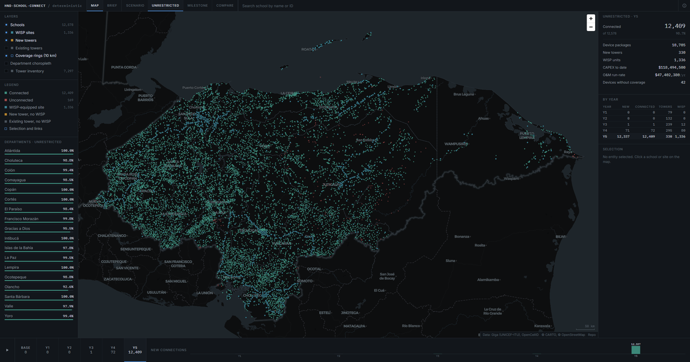

# Honduras school connectivity

A static analyst console for a school-connectivity plan for Honduras, where every figure on the page cites its source.

**Live site:** <https://farhangbakhs.github.io/honduras-connectivity/>



## What it does

The team modelled how to connect 12,578 unconnected Honduran public schools over five years on a US$125M budget, using a mixed-integer linear programme (MILP) with a tower, then WISP, then devices prerequisite chain. It compares two plans: an unrestricted plan that maximises year-5 coverage, and a milestone-constrained plan that must show annual progress. This site loads the full model output (every school, every site, both plans) with no upload step, no server and no API key. A **Map** view shows the schools and sites by year, and a **Brief** view gives a sectioned, cited policy brief with the formulation and references.

The unrestricted plan connects 12,409 schools (98.7%) by year 5. Requiring cumulative annual milestones of 10% to 30% reduces this to 9,363 (74.4%) on the same budget, a loss of 3,046 schools (24.2 percentage points). Both results are in `data/findings.json` and are re-checked by `scripts/build_data.py --check`.

## My role

This was team coursework. The MILP formulation was a team effort. I built the data pipeline, and on my own I built the public analyst console and the audit that compared the team report with the model output. The audit found 4 mismatches, recorded as M1 to M4 in `data/findings.json`.

## Run it

The site is static. It needs a local web server, because the browser blocks `fetch` from `file://`. Any server works, for example:

```sh
git clone https://github.com/Farhangbakhs/honduras-connectivity.git
cd honduras-connectivity
python -m http.server 8000     # then open http://localhost:8000
```

The basemap loads from CARTO, so it needs a network connection. Without it the app falls back to department outlines on a flat background and everything else still works.

To rebuild the data (Python 3, standard library only, run here with 3.14):

```sh
python scripts/build_data.py --check --audit   # writes data/app-data.json, prints computed-vs-report table and spatial audit
python scripts/build_boundaries.py             # data/hnd-adm1.json; downloads from geoBoundaries
```

Both commands reproduce the committed files exactly. `scripts/make_og.py` regenerates the social preview image and needs Pillow.

Keys: `←` `→` change year, `1` `2` `3` choose unrestricted, milestone or compare, `M` `B` switch Map and Brief, `/` focuses search, `Space` plays the year scrubber, `Esc` clears the selection. The state of the view is in the URL, so a scenario, year, department or school can be linked.

## How it works

```
data/raw/*.csv ──▶ scripts/build_data.py ──▶ data/app-data.json ──▶ js/data.js (decode, spatial index)
 (model output)      asserts + --check          columnar, one fetch        │
                                                                           ├─▶ js/map.js (MapLibre layers)
data/findings.json (every figure, with a source note) ───────────────────▶ ├─▶ js/ui.js  (rail, inspector, Brief)
                                                                           └─▶ js/charts.js (inline SVG)
```

- **The build script asserts the data it depends on.** It checks row counts, that both scenario files hold the same school IDs, and every column equivalence it uses to drop redundant columns. Why: a data refresh cannot silently break the published figures. Trade-off: a refresh that changes the shape of the data fails loudly until the script is updated.
- **Every hard-coded figure lives in `data/findings.json` with a source note.** `--check` compares the figures computed from the model output with the figures stated in the report. Why: a reader can trace any number on the page. Trade-off: a figure that is not in the file cannot appear on the page.
- **The payload is columnar.** Coordinates are integers offset from the bounding box at five decimal places, and the 6,400 distinct school names are deduplicated. Why: repeating ten JSON keys 12,578 times costs more than the values. Trade-off: the file is not readable by eye, and `js/data.js` must decode it.
- **School-to-site links are derived from distance, not exported from the solver.** The site labels them "derived". Why: the published files do not contain the solver's own assignment, and 82 milestone-plan schools meet both halves of the stated connection rule yet are flagged unconnected. Trade-off: the link drawn for a school is the most plausible site, not a proven one.
- **Headline figures keep the report's row counts, and the map draws each site once.** `MilestonesSites.csv` repeats site IDs. Why: the headline matches the report, and the map matches what exists. Trade-off: two conventions, both emitted and documented in `scripts/build_data.py` (mismatch M1).
- **MapLibre sources are built once.** Changing year or scenario updates paint and filter expressions only, and hover uses `feature-state`. Why: updates stay cheap at 12,578 schools. Trade-off: styling lives in expressions, which are harder to read than plain code.

## Testing and evaluation

There is no test suite. Correctness is checked by the build script:

- `python scripts/build_data.py --check` prints 25 computed-vs-report comparisons, and all read `ok`.
- `--audit` runs a spatial check with the haversine formula against the 10 km WISP rule. In the unrestricted plan, 12,408 of 12,409 connected schools have a WISP site within 10 km (1 violation). In the milestone plan, 9,363 of 9,363 do.
- The audit also finds 34 unreached schools in the unrestricted plan, and 82 in the milestone plan, that meet both halves of the stated connection rule. This is mismatch M3.

| | Bytes |
| --- | --- |
| 4 source CSVs and `legacy/baseline_data.js` | 3,460,121 |
| `data/app-data.json` | 992,232 (28.7%) |
| as served, gzipped | about 248,900 |
| `data/hnd-adm1.json` | 110,655 |

## Limitations

- **M1.** `MilestonesSites.csv` has 6,261 rows for 5,307 distinct sites, and 68 duplicated sites carry contradictory WISP flags. The report's totals of 164 new towers and 313 WISP units count rows. Counting distinct sites gives 156 and 302.
- **M3.** The report says the 169 schools the unrestricted plan does not connect lie beyond coverage. Against the output files, 34 of them have a WISP site in range and a device package. The claim is not repeated on the site.
- **M4.** The published files hold the 7,297 existing tower sites but not the candidate new-tower locations, and the baseline school list has duplicates. The setup figures (15,492 schools, 1,130 connected, 1,784 excluded) cannot be recomputed and come from the team report. No baseline school layer is drawn.
- The MILP itself (Python, Julia/JuMP, Gurobi) is not in this repository. The site shows its output.
- `legacy/` holds the original upload-driven dashboard. `scripts/build_data.py` still reads `legacy/baseline_data.js` for the existing tower inventory, so it stays.

## Deploy

GitHub Pages serves `main` from the repository root with HTTPS, so pushing to `main` redeploys. Every path in the site is relative, so it works from a repository subpath. `og:url` and `og:image` in `index.html` are absolute, because several link-preview scrapers do not resolve a relative `og:image`. Update them if the site moves.

## Data sources and licences

- School locations and connectivity status: Giga (UNICEF and ITU).
- Tower locations: OpenCellID.
- Department boundaries: geoBoundaries gbOpen HND ADM1 (OpenStreetMap and Wambacher), ODbL 1.0.
- Basemap: CARTO Dark Matter, © OpenStreetMap contributors.
- MapLibre GL JS 4.7.1, KaTeX 0.16.11, and IBM Plex fonts are vendored under `vendor/`.

The four original CSVs are in `data/raw/`, unmodified:
[NoMilestoneSchools](data/raw/NoMilestoneSchools.csv),
[NoMilestoneSites](data/raw/NoMilestoneSites.csv),
[MilestonesSchools](data/raw/MilestonesSchools.csv),
[MilestonesSites](data/raw/MilestonesSites.csv).
