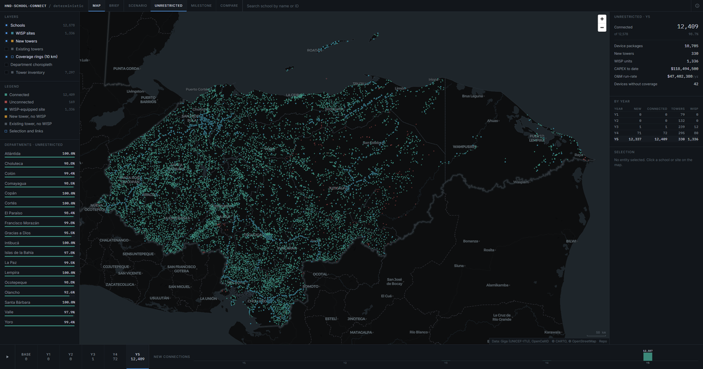

# Honduras school connectivity — deterministic MILP output

A static analyst console for a mixed-integer linear programme that plans internet connectivity for **12,578 unconnected Honduran public schools** over five years on a **$125M** budget, following a tower → WISP → devices prerequisite chain. Two plans are compared: an unrestricted one that maximises year-5 coverage, and a milestone-constrained one that must show annual progress. The site loads the full model output — every school, every site, both scenarios — with no upload step, no server and no API key.

**Live site:** <https://farhangbakhs.github.io/honduras-connectivity/>



---

## Summary

Honduras's public school system is largely offline. Of 15,492 public schools in the Giga dataset, 1,130 (7.3%) have an internet connection ([giga.global](https://giga.global/), [project report](https://github.com/Farhangbakhs/honduras-connectivity)). This brief evaluates how a fixed budget of US$125M over five years should be spent to connect the remaining schools with fixed wireless (WISP) infrastructure, and what it costs to require annual progress.

A multi-period mixed-integer linear programme (MILP) connects 12,409 of the 12,578 schools in scope (98.7%) by year 5 when the timing of investment is unrestricted. Requiring cumulative annual milestones of 10% to 30% of schools reduces this to 9,363 (74.4%) on an identical budget: a loss of 3,046 schools, or 24.2 percentage points.

The loss arises from operating cost rather than a shortage of capital. Each connected school incurs US$3,820 a year in operations and maintenance (O&M), charged against the same budget as construction, so schools connected early consume funds that would otherwise build infrastructure. For each additional school connected before year 5, approximately 1.06 schools are forgone at year 5.

The loss is also geographically concentrated. Under milestones, Islas de la Bahía, Olancho, Yoro and Francisco Morazán finish below 37% coverage against 74.4% nationally. These departments depend most on new towers at US$100,000 each, while budget is allocated in proportion to unconnected schools rather than to the cost of connecting them.

The full brief, with the formulation, assumptions and references, is in the **Brief** view on the site.

---

## Using it

The site opens on the **Map**. The **Brief** is a sectioned and cited policy brief covering the same ground: summary, key judgements with confidence levels, context, data, the full formulation in LaTeX, assumptions, results and recommendations, with a numbered reference list. Each section has an anchor, so `#formulation` links straight to it.

| | |
|---|---|
| `←` `→` | previous / next year |
| `1` `2` `3` | unrestricted / milestone-constrained / compare |
| `M` `B` | map view / brief view |
| `/` | focus search |
| `Space` | play or pause the year scrubber |
| `Esc` | clear selection |

Schools are drawn as circles and sites as angular glyphs — a hollow square for an existing tower, a solid square for a newly built one, and a diamond inside a broadcast ring for a WISP-equipped site — so the two separate by shape as well as colour. The **WISP coverage** layer draws every active 10 km footprint; it is off by default because it stacks heavily in dense areas. Clicking a school draws its 10 km radius, every site inside it, and a line to the site that most plausibly serves it. Clicking a site does the reverse. Compare colours each school by how the two plans differ at the selected year, which puts the 3,046-school gap directly on the map. The state of the view lives in the URL, so a particular scenario, year, department or selected school can be linked to.

---

## Rebuilding the data

Needs Python 3.9+ and nothing else. No npm, no build step at runtime.

```sh
# data/app-data.json  — both scenarios, one compact payload
python scripts/build_data.py --check --audit

# data/hnd-adm1.json  — department boundaries (downloads from geoBoundaries)
python scripts/build_boundaries.py
```

`build_data.py` asserts the row counts, the id-set identity between the two school files, and the equivalences it relies on when dropping redundant columns, so a future data refresh cannot quietly break the site.

| | Bytes |
|---|---|
| 4 source CSVs + `legacy/baseline_data.js` | 3,460,121 |
| `data/app-data.json` | 992,232 (28.7%) |
| … as served, gzipped | ~248,900 |
| `data/hnd-adm1.json` | 110,655 |
| `vendor/katex/` (JS + CSS + 20 woff2) | 558,541 |

KaTeX is not on the critical path: it is fetched only when the Brief is first
opened, and the browser pulls just the two or three maths fonts the formulae
actually use.

The payload is columnar rather than an array of objects, coordinates are integers offset from the bounding box at five decimal places, departments and municipios are integer codes against a lookup, and the 6,400 distinct school names are deduplicated.

Regenerating the social preview is a one-off that needs Pillow:

```sh
python scripts/make_og.py path/to/og-full.png   # 2400x1260 screenshot -> assets/og.png
```

---

## Layout

```
index.html              app shell, Map + Brief, Open Graph meta
css/app.css             design tokens and layout; no framework
js/main.js              boot, state store, keyboard, URL state
js/data.js              fetch, columnar decode, spatial index, aggregates
js/map.js               MapLibre sources and the paint/filter expressions
js/ui.js                rail, inspector, search, info panel, Brief
js/charts.js            inline SVG charts
data/app-data.json      both scenarios, loaded with one fetch
data/findings.json      every hard-coded figure, each with a source note
data/hnd-adm1.json      18 departments, simplified
data/raw/*.csv          the four original CSVs, unmodified
vendor/maplibre-gl/     MapLibre GL JS 4.7.1, pinned locally
vendor/katex/           KaTeX 0.16.11, loaded only when the Brief opens
vendor/fonts/           Inter and IBM Plex Mono, woff2
scripts/                build_data.py, build_boundaries.py, make_og.py
legacy/                 the original upload-driven dashboard
```

Rendering is MapLibre GeoJSON sources with `circle` layers for schools and `symbol` layers for sites, and no DOM markers. Site glyphs are drawn to a canvas at load and registered with the style, so there are no image files to fetch. Changing year or scenario updates paint and filter expressions; the sources are built once and never rebuilt. Hover uses `feature-state`. If the basemap fails to load, the app falls back to department outlines over a flat background and everything else still works.

---

## Deploy

Pages is already configured to serve `main` at `/ (root)` with HTTPS enforced, so
pushing to `main` redeploys. To change it: **Settings → Pages → Source: Deploy
from a branch → `main` / `(root)`**.

Every path in the site is relative, so it works from a repository subpath
without configuration. The two exceptions are `og:url` and `og:image` in
`index.html`, which are absolute because several link-preview scrapers will not
resolve a relative `og:image`; update them if the site moves.

---

## Sources

- School locations and connectivity status — Giga (UNICEF–ITU)
- Tower locations — OpenCellID
- Department boundaries — geoBoundaries gbOpen HND ADM1 (OpenStreetMap / Wambacher), ODbL 1.0
- Basemap — CARTO Dark Matter, © OpenStreetMap contributors

The four original CSVs are in `data/raw/`, unmodified, and linked individually from the site's info panel:
[NoMilestoneSchools](data/raw/NoMilestoneSchools.csv) ·
[NoMilestoneSites](data/raw/NoMilestoneSites.csv) ·
[MilestonesSchools](data/raw/MilestonesSchools.csv) ·
[MilestonesSites](data/raw/MilestonesSites.csv)
